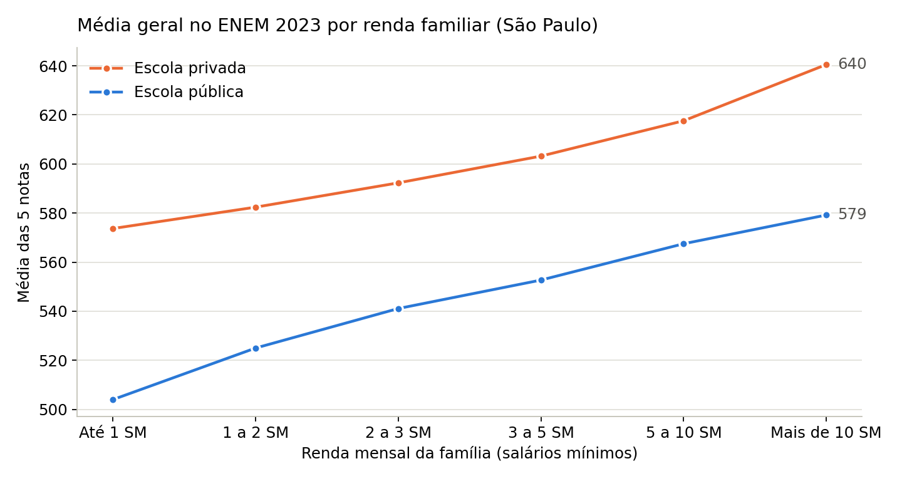
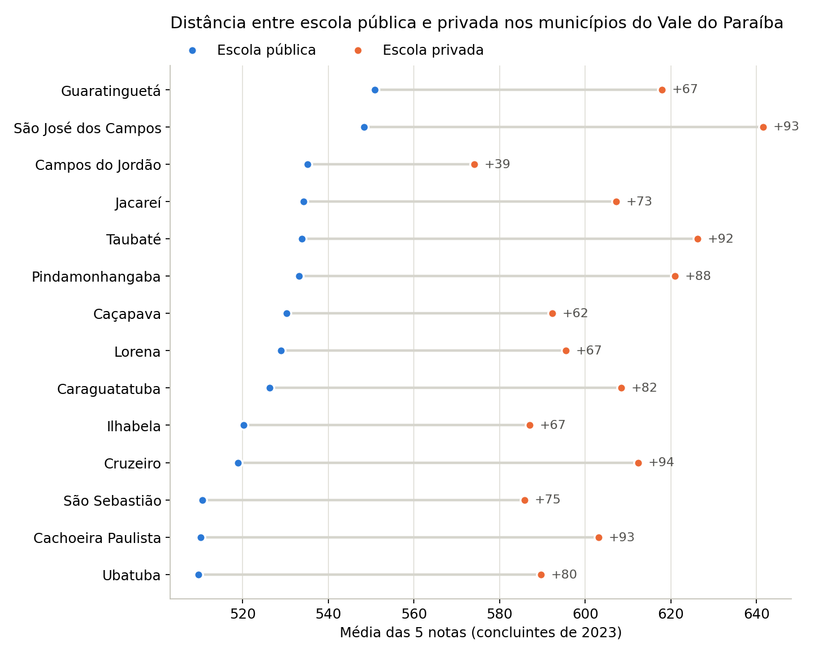
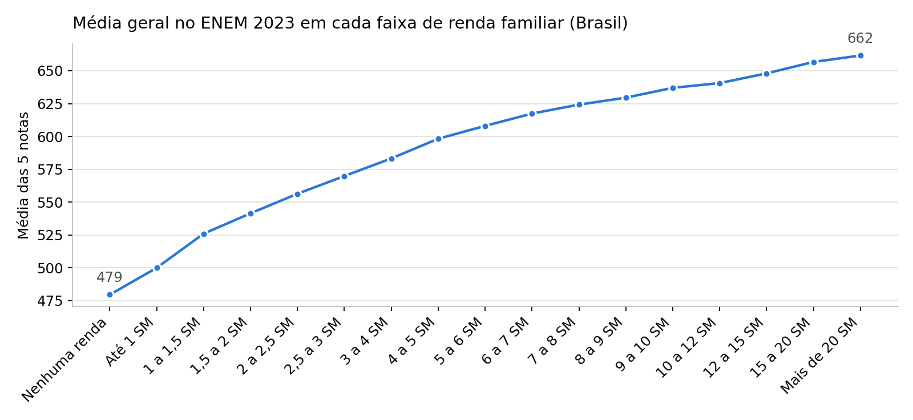

# Pipeline de dados com PySpark: desigualdade no ENEM 2023

[](https://colab.research.google.com/github/pdroozi/pipeline-pyspark-enem/blob/main/pipeline_enem_medalhao.ipynb)

Estudo prático de engenharia de dados com **Apache Spark**. Ele processa os microdados oficiais do ENEM 2023 (cerca de 4 milhões de inscritos) usando a **arquitetura medalhão** (bronze → prata → ouro) e responde a uma pergunta concreta:

> **Quanto a renda da família e o tipo de escola pesam na nota do ENEM, no Brasil, em São Paulo e no Vale do Paraíba?**

Tudo roda no navegador, pelo Google Colab.

---

## Por que este projeto existe

1. **Aprender engenharia de dados na prática.** Spark e arquitetura medalhão aparecem em quase toda vaga na engenharia de dados.
2. **Mostrar com dados públicos a desigualdade educacional**, em escala nacional e na região onde estudo (Vale do Paraíba, SP).

---

## Resultados

Resultados da execução com os microdados completos do ENEM 2023 (inscritos presentes nas quatro provas, sem treineiros):

- **A renda pesa muito:** no Brasil, a média geral vai de **479 pontos** (família sem renda) a **662 pontos** (mais de 20 salários mínimos). São 182 pontos de diferença, e a média sobe a cada faixa de renda, sem exceção.
- **O tipo de escola também:** entre os concluintes de 2023, quem estudou em escola privada teve média de **616** pontos, contra **516** na pública, uma diferença de 100 pontos no Brasil. Em São Paulo a diferença foi de 80 pontos (612 × 532) e no Vale do Paraíba, de 88 (623 × 535).
- **A escola pesa mesmo na mesma faixa de renda:** comparando famílias com renda parecida, a escola privada ainda fica de 52 a 78 pontos à frente no Brasil. Em São Paulo, quem estudou em escola privada com renda de até 1 salário mínimo (574) chega perto de quem estudou em escola pública com renda acima de 10 salários mínimos (579).
- **No Vale do Paraíba**, a distância entre pública e privada vai de 39 pontos em Campos do Jordão a 94 em Cruzeiro. Em São José dos Campos e Taubaté passa de 90 pontos.
- **Abstenção:** 34,6% dos inscritos no Brasil faltaram a pelo menos uma das provas (33,5% em SP; 32,7% no Vale).







As tabelas completas da camada ouro estão em [`resultados/`](resultados/) (CSV com ponto e vírgula, prontas para Excel ou Power BI).

---

## Como rodar (15 a 25 minutos)

1. Baixe o arquivo **Microdados do Enem 2023** (`microdados_enem_2023.zip`, cerca de 600 MB) na [página oficial do INEP](https://www.gov.br/inep/pt-br/acesso-a-informacao/dados-abertos/microdados/enem).
2. Envie o zip para o **Meu Drive** em [drive.google.com](https://drive.google.com).
3. Clique no botão **Abrir no Colab** no topo desta página.
4. No Colab, vá em **Ambiente de execução → Executar tudo** e autorize o acesso ao Google Drive quando o Colab pedir.
5. No final, um arquivo `resultados_enem_2023.zip` é baixado com as tabelas da camada ouro (CSV) e os gráficos.

Se o zip não estiver no Drive, o notebook tenta baixar direto do site do INEP. O site às vezes recusa conexões vindas do Colab, por isso o caminho pelo Drive é o recomendado.

---

## Arquitetura

```text
 CSV do INEP (1,7 GB, latin-1, separador ;)
   │
   ▼  BRONZE  cópia fiel em Parquet, tudo como texto, + metadados de ingestão
   │
   ▼  PRATA   20 colunas úteis, tipos corretos, códigos traduzidos,
   │          checagens de qualidade, particionada por UF
   │
   ▼  OURO    5 tabelas agregadas, prontas para gráficos e dashboards
```

| Camada | O que acontece | Por quê |
| --- | --- | --- |
| **Bronze** | Lê o CSV sem alterar nada (sem `inferSchema`) e grava em Parquet com `_arquivo_origem` e `_ingerido_em` | Se uma regra de limpeza estiver errada, refaz-se a prata sem baixar tudo de novo |
| **Prata** | Seleciona e renomeia colunas, converte notas para `double`, traduz códigos (escola, cor/raça, renda, município), calcula presença e média geral, roda checagens de qualidade e grava particionado por UF | Dado confiável e com significado para qualquer análise |
| **Ouro** | Agrega por recorte (Brasil, SP, Vale do Paraíba), renda e tipo de escola | Tabelas pequenas que respondem perguntas de negócio |

### Tabelas da camada ouro

| Tabela | Conteúdo |
| --- | --- |
| `renda` | Médias por faixa de renda (17 faixas), nos três recortes |
| `renda_e_escola` | Médias por faixa de renda agrupada (6 faixas) e tipo de escola |
| `escola` | Médias de concluintes de escola pública e privada |
| `municipios_vale` | Pública × privada em cada município do Vale do Paraíba |
| `presenca` | Inscritos, presentes e taxa de abstenção |

---

## Conceitos de Spark demonstrados

- **Avaliação preguiçosa** (*lazy evaluation*): transformações montam um plano, ações executam.
- **CSV → Parquet**: formato colunar e comprimido; o notebook mede o tamanho antes e depois.
- **`create_map`** para traduzir códigos sem UDF em Python (que seria muito mais lenta).
- **Broadcast join**: tabelas pequenas (faixas de renda, municípios) são copiadas para cada núcleo, sem embaralhar os 4 milhões de linhas.
- **Particionamento** por UF e **partition pruning**: o `explain()` mostra o Spark lendo só a pasta de SP.
- **`cache()`** para não reler a mesma base em várias agregações.
- **`pivot`** para comparar escola pública e privada lado a lado.
- **Checagens de qualidade de dados**: duplicidade, notas fora da escala 0–1000 e códigos sem tradução.

---

## Estrutura do repositório

```text
pipeline-pyspark-enem/
├── pipeline_enem_medalhao.ipynb   # o tutorial completo (rode no Colab)
├── graficos/                      # gráficos gerados pela execução
├── resultados/                    # tabelas da camada ouro em CSV
└── README.md
```

## Para continuar

- Troque `VALE_DO_PARAIBA` pelos municípios da sua região, ou o filtro de SP pelo seu estado.
- Crie uma tabela ouro por cor/raça dentro de cada faixa de renda.
- Rode o mesmo código no Databricks ou no AWS EMR, trocando os caminhos locais por caminhos do S3 ou do DBFS.

## Fonte e licença

Dados: [Microdados do ENEM 2023](https://www.gov.br/inep/pt-br/acesso-a-informacao/dados-abertos/microdados/enem), INEP. Código sob licença MIT.
